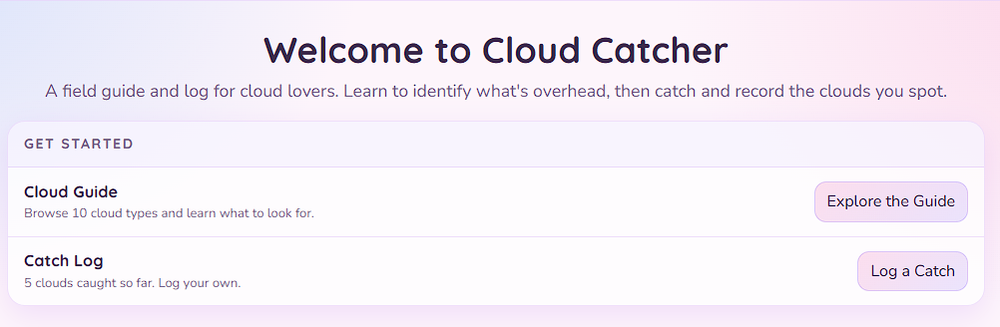
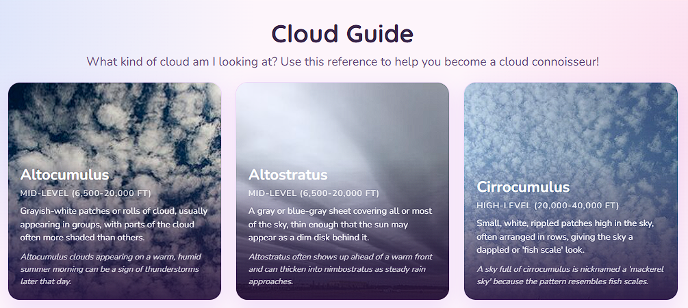
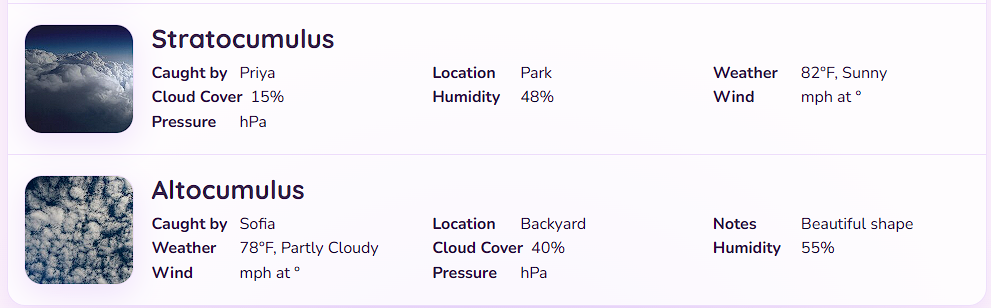

# Cloud Catcher

A full-stack web app for people who love clouds. Browse a reference guide to learn the different cloud types, then log the ones you spot — Cloud Catcher automatically grabs your location and pulls current weather conditions from a live weather API, so every entry in your catch log is a snapshot of the moment you saw it.

## Description

Cloud Catcher was built as a Project 2 solo full-stack application. The idea started from a girl who's always looking up at the sky wondering what she's looking at. I wanted a simple, fun way to actually learn to identify clouds in the moment by comparing what's in the sky to a reference guide, then keep a personal log of every cloud "caught" over time. A future version (planned for a later project) would add social and organizational features — trading clouds, sorting and filtering catches, viewing other users' collections, and more direct interaction between users.

**Core features:**
- **Cloud Guide** — browse real cloud genera (Cirrus, Cumulonimbus, Stratus, and more) with altitude, description, and a fun fact for each.
- **Catch Log** — log a sighting by picking who caught it, which cloud type, a location, and optional notes.
- **Live weather snapshot** — when you log a catch, the browser's Geolocation API captures your coordinates, which are sent to the OpenWeatherMap API to record temperature, wind, and humidity conditions at the moment of the sighting.
- **Responsive layout** — usable on both desktop and mobile screen sizes.

## Technologies Used

- **Node.js** & **Express.js** — server and RESTful routing
- **Handlebars.js** — server-rendered templating (MVC view layer)
- **PostgreSQL** — relational database
- **Sequelize** — ORM for models, associations, and queries
- **OpenWeatherMap API** — external API integration (exploration requirement)
- **Browser Geolocation API** — captures user coordinates client-side
- **bcrypt** — password hashing for stored user records
- **dotenv** — environment variable management
- **Render** — deployment/hosting, including the PostgreSQL database

## Screenshots

<!-- Add screenshots here, e.g.: -->
<!--  -->
<!--  -->
<!--  -->

## Live Application

[Live on Render](https://cloud-catcher.onrender.com/)

## Running Locally

```bash
git clone https://github.com/lexidevine/cloud_catcher.git
cd cloud_catcher
npm install
```

Create a `.env` file in the project root:
```
DB_NAME=cloud_catcher_db
DB_USER=your_postgres_username
DB_PASSWORD=your_postgres_password
OPENWEATHER_API_KEY=your_openweathermap_api_key
```

Create the database, then seed it:
```bash
npm run seed
npm start
```

Visit `http://localhost:3001`.

## Future Development

- User authentication (sessions/login)
- Trading clouds and viewing other users' collections (social/multiplayer features)
- Mobile-first responsive rewrite
- Filtering/sorting the catch log
